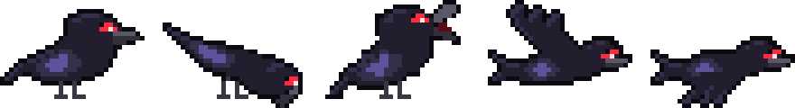
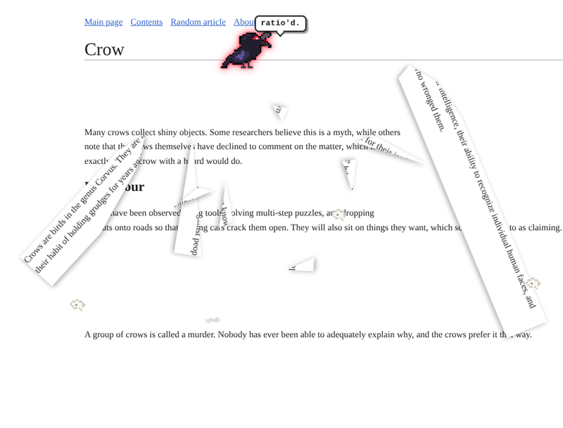
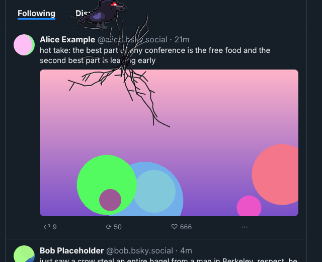
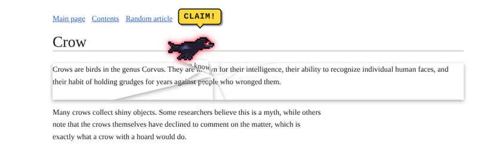
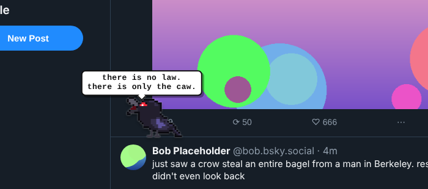

# corvid



**Evil Crow**, a Chrome extension. Click the toolbar icon and a pixel crow with a glowing red eye lands on whatever page you're on and starts wrecking it. It was made with Bluesky in mind, but it works anywhere.

> there is no law. there is only the caw.



## What it does

- **Shatters things.** It pecks a post, cracks spread out from its beak, then the post breaks into shards that tumble off the screen with the real text still on them.
- **Steals shiny things.** It grabs images and avatars, yells **CLAIM!**, and flies them to its hoard, a nest in the bottom-right corner with a running count.
- **Cawifies bisks.** It turns your post into `Caw caaaaaw kraa caw` and keeps the capitalization (and the occasional stray `CLAIM`).
- **Eats words.** It hops along a line and eats it one word at a time while the letters fall like crumbs. Then it says `*burp*`.
- **Knocks buttons off the page.** Like, repost and reply buttons get kicked into the void ("unliked.").
- **Sits on posts** until they go crooked ("heavy bird.").
- **Splats.** Sometimes, while flying over.

None of it is real. The crow never clicks, likes, posts or deletes anything, and reloading the page (or using *Repair the page*) puts everything back.



## Install

Works in Chrome, Arc, Brave, Edge, or any other Chromium browser.

1. Clone this repo (or use **Code → Download ZIP** and unzip it). Keep the folder somewhere it can stay.
2. Go to `chrome://extensions` and turn on **Developer mode** (top right).
3. Click **Load unpacked** and pick this folder, the one with `manifest.json` in it.
4. Pin the crow: puzzle-piece icon → pin **Evil Crow**.

To update later, pull (or replace the files), then hit the ↻ reload arrow on the Evil Crow card.

## Use

| | |
|---|---|
| **Click the icon** | Summons a crow. Click again for another one (up to 12). |
| **Right-click the icon** | *Summon a murder* (5 crows) · *Banish the crows* · *Repair the page* · toggle sound · *Crow lives on Bluesky* (auto-summon on bsky.app) |
| **Alt+Shift+C / Alt+Shift+X** | Summon / banish. You can change these at `chrome://extensions/shortcuts`. |
| **Click a crow** | Pokes it. It gets **angry**: red glow, faster, and it prefers shattering. Every 5th poke it calls for backup. |
| **Click the nest** | Asks about the hoard. Don't. |





## Notes

- Sound kicks in after you've clicked somewhere on the page once, because browsers block autoplay. Every sound (the caws, the crunches, the glass breaking) is synthesized live with Web Audio, so there are no audio files.
- On Bluesky the crow knows what posts, post text, avatars and buttons are. Everywhere else it figures things out by poking around.
- Chrome doesn't let extensions run on `chrome://` pages or the Web Store. If you try, the badge says "no".
- All the art is hand-placed pixels stored as strings in `sprites.js`.

## Files

```
manifest.json   MV3 manifest
background.js   toolbar button, right-click menu, shortcuts
crow.js         the havoc engine (crow brain, physics, shattering, sound)
sprites.js      pixel art: crow frames, nest, feather, splat
icons/          toolbar icons
```

